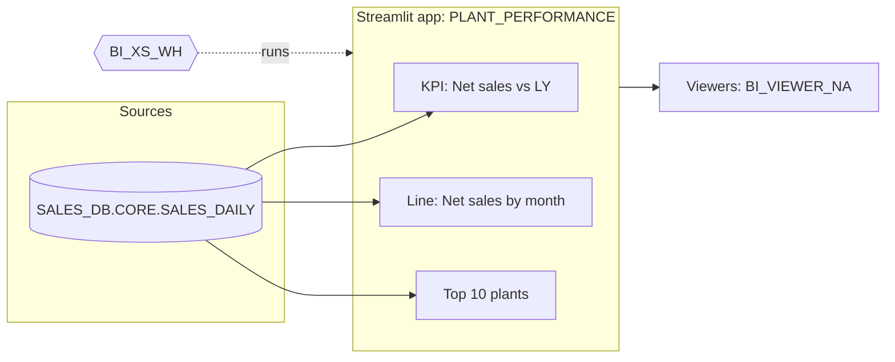

# Hand-off pack templates

## handoff/HANDOFF.md
```markdown
# Hand-off: <project>
**From:** <analyst> · **To:** <receiving_team> · **Date:** <date> · **Intake:** <handoff.intake>
<one row per standards handoff.required_fields, e.g. **Business owner:** … · **Refresh need:** … · **Expected viewers:** …>

## What it does
<2–3 sentences from the brief's outcome. Who uses it and for which decision.>

## Where it is now
| Thing | Location | Owner role | Shared with |
|---|---|---|---|
| Streamlit app | BI_KIT_DEMO.PROTO_JDOE.PLANT_PERFORMANCE | BI_ANALYST | (none) |

## Data it uses
| Source | Owner | Policies | Used for |
|---|---|---|---|
| SALES_DB.CORE.SALES_DAILY | DATAENG_ROLE | region row access policy | all visuals |

Number to match: <measure> = <value> → **matches** in the prototype.

## What production needs
- Refresh: <from brief; who owns the pipeline that keeps sources fresh>
- Access: viewers <roles>; **rows per viewer**: <owner's vs caller's rights decision>
- Compute: <warehouse, compute pool, EAI>
- Grants (review, don't run as-is):
  ```sql
  GRANT USAGE ON DATABASE … TO ROLE <app_owner>;
  GRANT SELECT ON VIEW … TO ROLE <app_owner>;
  GRANT USAGE ON STREAMLIT … TO ROLE <viewer_role>;
  ```

## Prototype-grade (needs work)
- <specific items>

## Check results
<Fix now / Worth considering counts and the open items; full report in CHECK_REPORT.md>

## Open questions
- <only real ones>

## Files in this pack
README.md · architecture.md · PROJECT_BRIEF.md · CHECK_REPORT.md · production/ (debug off)
```

## handoff/README.md
```markdown
# <project>
<One-paragraph purpose.> Built with snow-bi-kit.

## Run it
- In Snowflake: <app URL / location>
- Locally: `pip install -r requirements.txt` (or env file) then `streamlit run streamlit_app.py` with a Snowflake connection.

## How it's built
- Every chart goes through the app's `run_visual` helper (SQL + optional Python step) and is drawn from that result.
- "How this was built" panels are on in the prototype (`DEBUG = True`) and off in `production/`.
- Brand and formats: the `BRAND` block at the top of the app (from company standards).

## Business owner / contacts
<owner> · <analyst>
```

## handoff/architecture.md
Mermaid only, left-to-right, real object names:
````markdown

````
